# ambientCG: Ground materials

**13 assets from [ambientCG](https://ambientcg.com), dedicated to the public domain under [CC0](https://docs.ambientcg.com/license/).** Use them in any game, free or paid, and change them however you like; no credit is needed.

PBR materials as 1K and 2K JPG maps (colour, normal GL and DX, roughness, AO, displacement), one folder per resolution. 527.2 MB in all.

This is a copy kept by [zuujis-cc0](https://github.com/zuujis-cc0) so game makers can take single files from GitHub. It is not made by or affiliated with ambientCG: the originals, often in more formats and higher resolutions, are on [ambientcg.com](https://ambientcg.com). If they help you, consider [supporting ambientCG](https://www.patreon.com/ambientCG).

Every file is listed in [MANIFEST.tsv](MANIFEST.tsv) with its size and SHA-256. More free assets: [the Zuujis collection](https://github.com/zuujis-cc0/free-game-assets#readme).

| | | | |
| :-: | :-: | :-: | :-: |
| <a href="Ground100">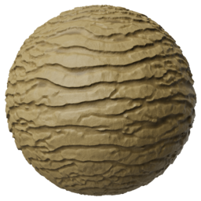</a> <b><a href="Ground100">Ground 100</a></b> by ambientCG · <a href="https://ambientcg.com/a/Ground100">source</a> | <a href="Ground101">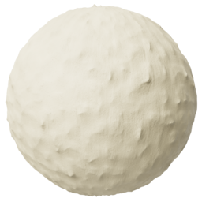</a> <b><a href="Ground101">Ground 101</a></b> by ambientCG · <a href="https://ambientcg.com/a/Ground101">source</a> | <a href="Ground102">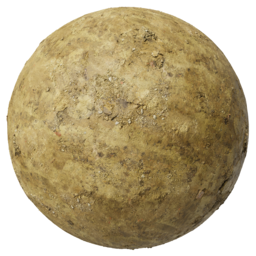</a> <b><a href="Ground102">Ground 102</a></b> by ambientCG · <a href="https://ambientcg.com/a/Ground102">source</a> | <a href="Ground103">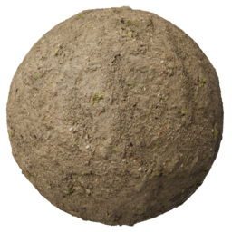</a> <b><a href="Ground103">Ground 103</a></b> by ambientCG · <a href="https://ambientcg.com/a/Ground103">source</a> |
| <a href="Ground104">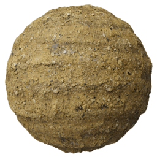</a> <b><a href="Ground104">Ground 104</a></b> by ambientCG · <a href="https://ambientcg.com/a/Ground104">source</a> | <a href="Ground105">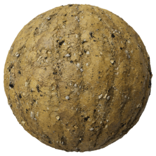</a> <b><a href="Ground105">Ground 105</a></b> by ambientCG · <a href="https://ambientcg.com/a/Ground105">source</a> | <a href="Ground106">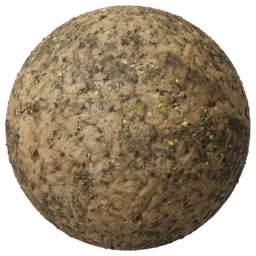</a> <b><a href="Ground106">Ground 106</a></b> by ambientCG · <a href="https://ambientcg.com/a/Ground106">source</a> | <a href="Ground107">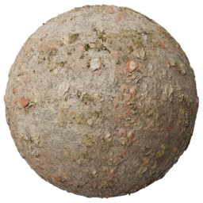</a> <b><a href="Ground107">Ground 107</a></b> by ambientCG · <a href="https://ambientcg.com/a/Ground107">source</a> |
| <a href="Ground108">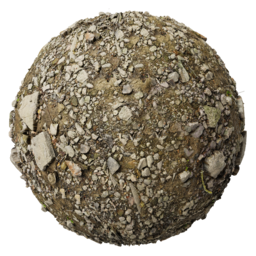</a> <b><a href="Ground108">Ground 108</a></b> by ambientCG · <a href="https://ambientcg.com/a/Ground108">source</a> | <a href="Ground109">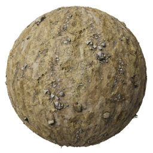</a> <b><a href="Ground109">Ground 109</a></b> by ambientCG · <a href="https://ambientcg.com/a/Ground109">source</a> | <a href="Ground110">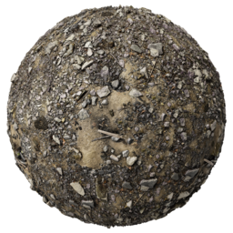</a> <b><a href="Ground110">Ground 110</a></b> by ambientCG · <a href="https://ambientcg.com/a/Ground110">source</a> | <a href="Ground111">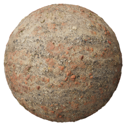</a> <b><a href="Ground111">Ground 111</a></b> by ambientCG · <a href="https://ambientcg.com/a/Ground111">source</a> |
| <a href="Ground112">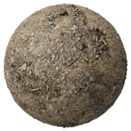</a> <b><a href="Ground112">Ground 112</a></b> by ambientCG · <a href="https://ambientcg.com/a/Ground112">source</a> |  |  |  |

---

Kept up to date by this repository's own [update workflow](.github/workflows/update.yml), with code and plan from [cc0-mirror](https://github.com/zuujis-cc0/cc0-mirror). Something wrong? [Open an issue there](https://github.com/zuujis-cc0/cc0-mirror/issues/new) or use the [private report form](https://games.zuujis.com/report).
